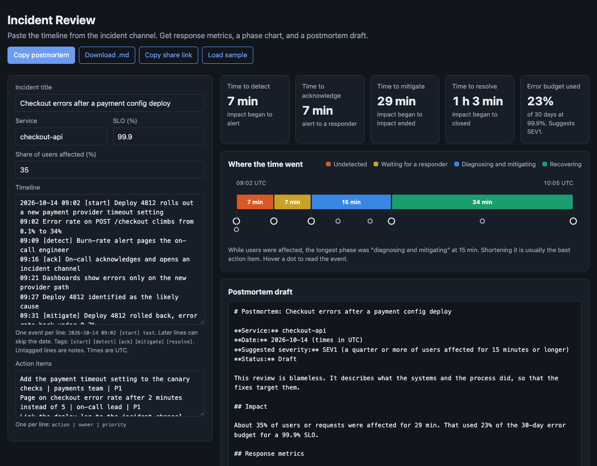

# Incident Review

A browser tool for the hour after an incident. Paste the timeline from the incident channel with a few tags, and get the response metrics, a chart of where the time went, and a blameless postmortem draft in Markdown, ready for the review meeting.



## Why

Postmortems are where teams learn from outages, and they are often written days later from memory. The facts are scattered across a chat channel, the metrics get computed by hand or skipped, and the meeting spends its time reconstructing what happened instead of deciding what to change.

This tool does the mechanical part right away so people can spend the review on judgment:

- **Response metrics** from the tagged milestones: time to detect, acknowledge, mitigate, and resolve.
- **A phase chart** showing how long the incident sat undetected, waited for a responder, took to diagnose and mitigate, and took to recover. The longest phase while users were affected is called out, since shortening it is usually the best action item.
- **Impact in error budget terms.** Impact minutes are weighted by the share of users affected and compared with the 30-day budget for the SLO, so "29 minutes at 35%" becomes "23% of the month's budget".
- **A suggested severity** from a simple, stated rubric. Teams have their own, so it is labeled as a suggestion.
- **A postmortem draft** with the header, impact, metrics, a timeline table with offsets from the start, and action items. The sections that need people, like what went well, what went wrong, and where the team got lucky, are left blank on purpose.

## Timeline format

One event per line. Later lines can skip the date, and a time earlier than the line before it rolls over to the next day, since incidents cross midnight.

```
2026-10-14 09:02 [start] Deploy 4812 rolls out a new payment provider timeout setting
09:09 [detect] Burn-rate alert pages the on-call engineer
09:16 [ack] On-call acknowledges and opens an incident channel
09:31 [mitigate] Deploy 4812 rolled back, error rate back under 0.2%
10:05 [resolve] Monitoring stable for 30 minutes, incident closed
```

Tags are `[start]`, `[detect]`, `[ack]`, `[mitigate]`, and `[resolve]`. Untagged lines are notes. Lines that don't parse, unknown tags, missing milestones, and milestones out of order are all reported with line numbers. Action items are one per line as `action | owner | priority`.

The sample incident is made up.

## Run it

It is a static site with no build step and no dependencies.

- **GitHub Pages:** enable Pages for the repo and serve from the root of the default branch.
- **Locally:** ES modules need a web server, so `file://` will not work. From this folder run:

```bash
python3 -m http.server 8000
```

Then open http://localhost:8000.

The draft is kept in the page URL, so "Copy share link" captures it, and in the browser, so a refresh doesn't lose it. Nothing is uploaded anywhere.

## Tests

The parser, metrics, and Markdown output live in `src/incident.js` with no DOM code, so they run under Node's built-in test runner.

```bash
npm test
```

13 tests cover parsing the sample, metrics checked by hand, midnight rollover, error messages with line numbers, missing and out-of-order milestones, the error budget math, the severity rubric, phases, action items, the Markdown draft, escaping pipes in tables, and the URL round-trip.

## License

MIT. See [LICENSE](LICENSE).
